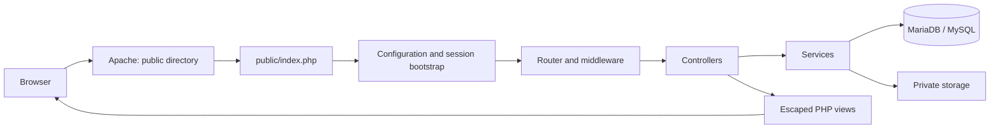

# Architecture

Rankers Mind CRM is a server-rendered PHP application. It uses a custom MVC layer
and PDO rather than a full framework. Browser interactions use vanilla JavaScript
and third-party UI libraries; there is no frontend compilation step.

## Responsibilities

| Location | Responsibility |
| --- | --- |
| `app/Config` | Environment parsing, application/database settings and entity metadata |
| `app/Core` | Routing, validation, database connection and transactions |
| `app/Middleware` | Authentication, guest restrictions, permissions and CSRF |
| `app/Controllers` | HTTP input, authorization, redirects and view selection |
| `app/Services` | Billing, payroll, tickets, uploads, client accounts and other workflows |
| `app/Views` | Server-rendered HTML and printable documents |
| `database` | Schema, system defaults and migrations |
| `storage` | Private runtime data excluded from Git |

The bootstrap loads `.env`, registers autoloading, creates runtime directories,
configures session cookies and installs exception handling. Process environment
variables take precedence over the local environment file, enabling isolated CI.

## Data and access boundaries

The normalized schema uses foreign keys, financial decimal columns and junction
tables for multiple assignees. Related changes should use `Database::transaction()`.
Permissions alone do not establish ownership: staff assignments and the client linked
to the current portal account must also restrict record access.

The production seed contains system defaults, not demo accounts. `install.php` creates
the first administrator from environment variables and applies migrations. It is an
explicit operator action; it is not automatically run on web requests or container restarts.

## Operational behavior

`/health` performs a database connectivity probe and returns a minimal 200/503 JSON
response. It does not check migrations or every dependency. Application exceptions
go to private logs; non-debug HTTP responses hide details, and CLI exceptions exit 1.

Current limits include compact legacy controllers/templates, historical demo-dependent
acceptance scripts and no measured whole-application coverage threshold. PHPStan level 1
checks application logic; PHP templates receive syntax/correctness checks because view
variables are injected at runtime. See [testing](testing.md) for the actual enforced scope.
